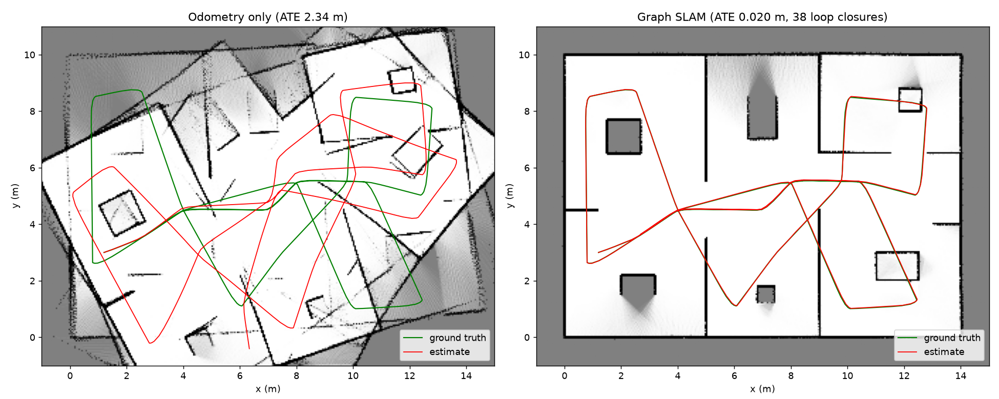
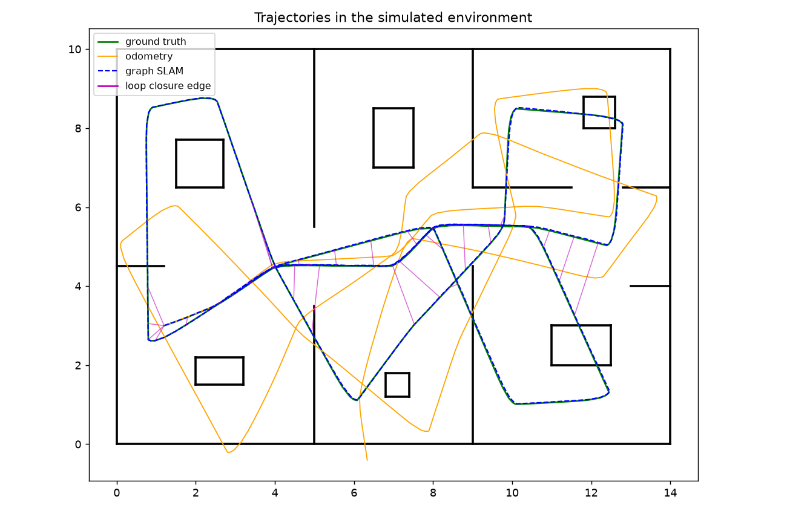
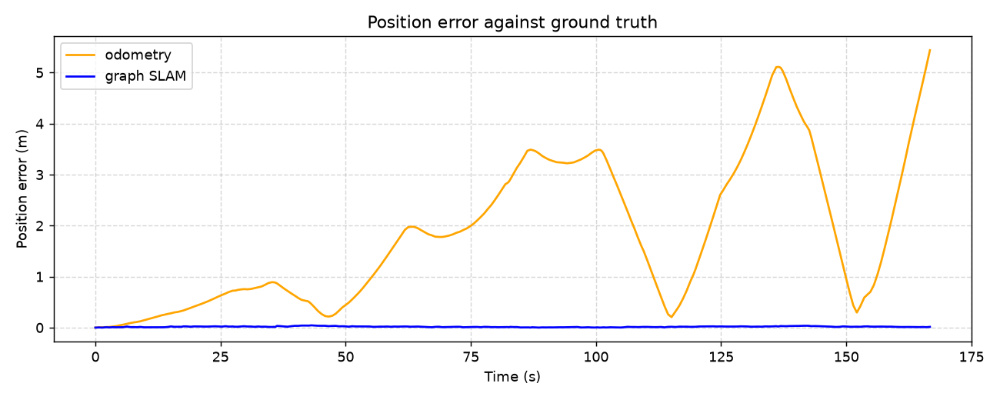

# ROS 2 SLAM on Raspberry Pi 5

2D SLAM for a mobile robot. The repo has two parts:

- `python_sim/`: a graph SLAM written from scratch in Python (ICP scan matching, loop closure, pose graph optimisation, occupancy grid) and run on a simulated indoor environment.
- `slam_bot/`: a ROS 2 Jazzy package that runs `slam_toolbox` on a TurtleBot3 in Gazebo or on a Raspberry Pi 5 with an RPLIDAR.



## Python graph SLAM
The simulated robot drives 71 m through three rooms with doors and furniture. It carries a 360-beam LiDAR (8 m range, 1.5 cm noise) and wheel odometry with 1.5 % scale error, noise and a 0.006 rad/s gyro bias.

1. **Front end.** A keyframe is added every 0.3 m or 15°. Each new scan is aligned with ICP to a submap of the last six keyframes, starting from the odometry guess.
2. **Loop closure.** When the robot comes within 2 m of a keyframe at least 40 keyframes old, the scan is matched against that part of the map. The match is kept only if over 85 % of points fall within 10 cm and the RMS error is under 4 cm.
3. **Back end.** Keyframe poses and the relative-pose constraints form a pose graph, solved with `scipy.optimize.least_squares` using a sparse Jacobian after every accepted loop closure.
4. **Map.** A log-odds occupancy grid at 5 cm resolution is built from the optimised poses.

| | ATE RMSE | Max error | Heading RMSE |
|---|---|---|---|
| Odometry only | 2.34 m | 5.44 m | 32.7° |
| Graph SLAM (260 keyframes, 38 loop closures) | 0.020 m | 0.045 m | 0.30° |




Trajectories for every keyframe (ground truth, odometry and SLAM) are in `python_sim/results/trajectories.csv`, and the final map is `python_sim/results/map_slam.png`.

```bash
pip install numpy scipy matplotlib
cd python_sim && python slam2d.py
```

## ROS 2 package
```
 Gazebo / RPLIDAR ──/scan──► slam_toolbox ──/map, TF map→odom──► RViz2
        ▲                         ▲
        │ /cmd_vel                │ TF odom→base_link (odometry)
   wander node ◄──/scan───────────┘
```

In simulation the `wander` node drives the TurtleBot3 around and steers away from obstacles using the LiDAR, so the map builds without teleop. On the real robot the Pi runs the RPLIDAR driver and `slam_toolbox`, and RViz runs on a laptop on the same network.

### Setup
```bash
sudo apt install ros-jazzy-slam-toolbox ros-jazzy-turtlebot3-gazebo \
                 ros-jazzy-turtlebot3-description ros-jazzy-rplidar-ros
mkdir -p ~/ros2_ws/src && cd ~/ros2_ws/src
git clone https://github.com/MinhHieu15/ros2-slam-rpi5.git
cd ~/ros2_ws && colcon build --symlink-install && source install/setup.bash
```

### Simulation
```bash
export TURTLEBOT3_MODEL=burger
ros2 launch slam_bot sim_slam.launch.py
ros2 run nav2_map_server map_saver_cli -f ~/maps/tb3_world
```

### Raspberry Pi 5
```bash
ros2 launch slam_bot rpi5_slam.launch.py serial_port:=/dev/ttyUSB0
```
On the laptop, with the same `ROS_DOMAIN_ID`:
```bash
rviz2 -d $(ros2 pkg prefix slam_bot)/share/slam_bot/config/slam.rviz
```
`config/slam_toolbox.yaml` updates the map less often than the defaults to keep the CPU load down on the Pi. The robot's base driver publishes `odom → base_link` from wheel odometry.

### `wander` parameters
| Parameter | Default | |
|---|---|---|
| `linear_speed` | 0.15 m/s | forward speed |
| `angular_speed` | 0.8 rad/s | turn rate when avoiding |
| `safe_distance` | 0.45 m | clearance needed ahead |
| `stamped` | true | publish `TwistStamped` instead of `Twist` |
